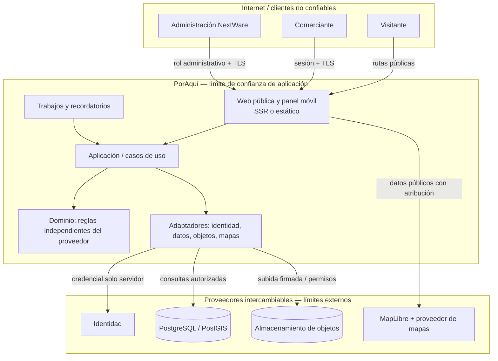

# 05. Arquitectura técnica propuesta

> **Producto:** PorAquí · **Empresa:** NextWare  
> **Estado:** Borrador para revisión · **Responsable propuesto:** Liderazgo técnico + desarrolladores  
> **Versión:** 0.1 · **Actualizado:** 2026-10-24 · **Cobertura:** Santiago Ixcuintla, Nayarit  
> **Nota:** No es una decisión aprobada hasta que el equipo la valide y actualice el estado.

## Estado de la arquitectura
**Arquitectura aceptada por el usuario (31-10-2026):** Next.js + TypeScript para frontend y NestJS + TypeScript como API independiente. Astro + API queda como alternativa evaluada, no seleccionada. No se eligen proveedor de hosting, identidad, Postgres administrado, objetos, mapas ni servicios gestionados. La aceptación es arquitectónica; no implica implementación ni validación práctica de seguridad, costos o recuperación.

## Objetivos arquitectónicos
Bajo costo inicial, páginas públicas rápidas e indexables, panel móvil, independencia de datos, políticas de acceso por negocio, facilidad de exportación y posibilidad de futuras integraciones con SaaS independientes sin reconstruir el núcleo.

## Diagrama lógico

## Componentes previstos
- **Web pública:** portada de marketplace local con categorías, destacados y espacios promocionales; búsqueda, lista/mapa, fichas y catálogo; SEO, enlaces compartibles y analítica mínima.
- **Panel privado:** gestión de negocio/catálogo, carga de fotos, confirmación de vigencia y atención de reportes.
- **Backend/API:** validación, autorizaciones, búsquedas, flujos administrativos y reglas transaccionales.
- **Base de datos:** negocios, sucursales, membresías, productos, servicios, reportes, invitaciones y eventos agregados.
- **Almacenamiento de objetos:** fotos optimizadas, validación de tipo y tamaño, metadatos en base de datos.
- **Mapas:** mapas y coordenadas separadas de los datos comerciales; el proveedor debe permitir uso comercial.
- **Recordatorios:** tareas programadas e idempotentes, límites para evitar envíos repetidos.
- **Destacados y promociones:** selección manual o reglas iniciales basadas en categoría, ubicación, rotación, búsquedas y calificaciones; publicidad pagada como evolución posterior y claramente identificada.
- **Calificaciones y moderación:** calificaciones públicas con controles de abuso; detección de picos, limitación temporal y revisión administrativa sin despublicación automática.

### Límite del MVP y evolución

**MVP:** web pública móvil e indexable, búsqueda/listado/ficha, catálogo, panel de comerciante, autenticación y autorización por membresía, calificaciones públicas autenticadas y moderación. Recordatorios avanzados, automatización, publicidad pagada, analítica avanzada y clientes SaaS integrados son evolución posterior o P1; no justifican separar procesos en el MVP.

## Decisiones técnicas aún abiertas
| Tema | Alternativa estudiada | Prueba necesaria |
|---|---|---|
| Frontend | Next.js + TypeScript modular o Astro; sin decisión aprobada | SEO, formularios, panel móvil y costo/operación; revisar en fase autorizada |
| Base de datos | PostgreSQL/PostGIS administrado | Búsqueda textual y geoespacial, cuotas y recuperación |
| Backend | Casos de uso modulares integrados o API independiente (NestJS candidata); sin decisión aprobada | Auth, aislamiento, costos, rendimiento y complejidad operativa |
| Objetos | R2 u otro S3-compatible | Subida segura, caché, costo de lecturas y respaldo |
| Mapas | MapLibre + proveedor externo | Atribución, cobertura local y límites de uso |
| Auth | Proveedor administrado / OIDC futuro | Invitaciones, revocación y multi-negocio |
| Calificaciones | Públicas en MVP; requiere cuenta verificada para publicar según política definida | Moderación, apelación y calibración de umbrales con datos del piloto |
| Destacados | Selección manual + reglas iniciales | Señales, rotación y transparencia; publicidad pagada posterior |

## Límites entre componentes
- **Datos privados no salen en endpoints públicos.**
- **El frontend no controla permisos**: toda edición valida identidad y membresía en servidor o políticas RLS auditadas.
- **Los archivos se cargan por URLs firmadas** o proceso autenticado equivalente; los objetos públicos se sirven a través de rutas controladas.
- **Los SaaS externos no leen directamente la base de PorAquí.** Integraciones futuras usarán contratos versionados, eventos y consentimiento.

Las calificaciones públicas pertenecen al alcance del MVP. La política de producto definida requiere cuenta con contacto verificado y limita una calificación editable por cuenta/negocio, sin comentarios públicos; la revisión humana, apelación y retención deben aplicarse sin depender del framework. Los umbrales automáticos se calibran con datos del piloto. La identidad y la autenticación para calificar deben respetar esta política al elegir proveedor.

## Evaluación de alternativas para ADR-006 (31-10-2026)

**Prioridad acordada:** minimizar costo inicial y carga operativa, sin comprometer seguridad, SEO, portabilidad ni uso comercial. Un plan gratuito no se considera adecuado solo por ser gratuito; hay que comprobar sus condiciones y límites vigentes.

### Frontend y API

| Opción | Ventajas para PorAquí | Costos y riesgos | Evaluación |
|---|---|---|---|
| Next.js + NestJS + TypeScript, dos aplicaciones | Límites explícitos entre UI y API; NestJS como contrato que puede servir clientes futuros; Next.js SSR/SEO y panel. | Dos aplicaciones/despliegues, contratos de red y más operación; no hay medición de si reutilización futura compensa el costo en MVP. Vercel Hobby limita uso comercial; Pro publica precio por asiento. | **Seleccionada por el usuario** como arquitectura; verificar costo/hosting comercial antes de elegir proveedor. |
| Next.js con backend integrado | Menos componentes e infraestructura; un solo equipo/despliegue para el MVP. | El usuario la descarta expresamente. Hosting Node/Next aún requeriría verificación comercial. | Descartada para esta evaluación por decisión expresa del usuario, no por limitación técnica. |
| Astro + API pequeña separada | Salida estática eficiente para páginas públicas y contenido; SSR disponible con adaptador cuando se requiere; JavaScript por demanda. | Panel interactivo y flujos de usuario pueden necesitar más islas/integraciones; mantener API separada aún implica operar dos componentes. | Candidata si el sitio público domina y las pruebas de panel confirman una experiencia adecuada. |

**Evaluación documental (sin implementación):** ambas opciones separadas permiten mantener el dominio fuera de la interfaz y exponer una API propia. Astro puede servir páginas pre-renderizadas y también SSR bajo demanda mediante adaptador y endpoints; por ello no se descarta por falta de capacidad. Next.js ofrece SSR/estático para rutas dinámicas y combina React para la ficha/listado con una aplicación TypeScript que comparte ecosistema conceptual con NestJS. Para PorAquí —fichas/catálogos dinámicos, búsqueda, panel autenticado, roles por negocio, moderación— recomiendo Next.js + NestJS sobre Astro + API: es una apuesta por coherencia de framework en web dinámica y separación explícita del backend, con menor riesgo de que el panel dependa del modelo de islas/hidratación y mezcla de integraciones de Astro. Esto es una inferencia arquitectónica, no medición comparativa; requiere comprobar que el equipo puede operar dos aplicaciones y que el costo de API separada se justifica.

**Incertidumbres de proveedor (comparación documental, no prueba):**
- **Hosting:** documentar límites de runtime, funciones SSR, uso comercial, cuotas y costo fijo/variable. Las cifras y términos actuales referenciados abajo deben reconfirmarse al decidir, con volumen mensual y perfiles de uso del piloto; no hay presupuesto/volumen aprobado para calcular un total comparable.
- **Identidad:** cualquier proveedor o solución propia debe soportar contacto verificado, invitaciones seguras de un uso, revocación y membresía multi-negocio; confirmar dónde se aplica autorización y cómo exportar o migrar identidades sin exponer credenciales.
- **Almacenamiento:** comparar R2/S3-compatible por costo total de almacenamiento, operaciones, entrega, carga firmada, validación, respaldo y exportación de originales/derivados; hoy no existe inventario ni volumen de fotos para estimación.
- **Mapas:** MapLibre no aporta por sí solo mapas/tiles ni geocodificación. Confirmar uso comercial, atribución, cobertura local, cuotas, costo de consultas y portabilidad de coordenadas; no se han comparado proveedores concretos con datos de cobertura de Santiago Ixcuintla.

**Decisión arquitectónica aceptada por el usuario:** **Next.js + NestJS**. La aplicación pública necesita páginas dinámicas de negocios/catálogos indexables junto con búsqueda, y el panel autenticado necesita flujos de escritura y autorización; mantener SSR y API en frameworks TypeScript complementarios reduce el cambio de paradigma entre capa pública e interacción privada y define una frontera API explícita. Astro también soporta SSR bajo demanda con adaptador, endpoints y modos mixtos; no se descarta por incapacidad, pero su ventaja principal (sitio mayormente de contenido estático con JavaScript mínimo) es menos determinante para este marketplace dinámico. **Costo:** dos aplicaciones, contratos/red, despliegues, observabilidad y operación adicionales; no existe medición empírica del costo total ni evidencia de piloto. La aceptación no elige hosting, proveedor de identidad, base administrada u objetos.

### Comparación por los mismos criterios

| Criterio | Next.js + NestJS | Astro + API pequeña |
|---|---|---|---|
| Costo creciente | Frontend SSR y API añaden cómputo/red; el total depende de proveedor, tráfico y duplicación de servicios administrados. | Sitio estático puede reducir cómputo público, pero API/SSR dinámico, mapas y medios siguen generando costo. |
| Páginas públicas / SEO | SSR/estático y rutas dinámicas; buen encaje con fichas y catálogos cambiantes. | Buen soporte estático y SSR bajo demanda con adaptador; exige elegir modo/adapter y validar rutas de fichas dinámicas. |
| Panel móvil e interacción | React para interfaz compleja; compartir ecosistema web React/TypeScript con API Nest. | Islas permiten hidratación parcial; validar integración, estado compartido y ergonomía de formularios del panel. |
| Autorización y aislamiento | API Nest aplica identidad, membresía y autorización por recurso; Next jamás decide permisos. | API separada aplica los mismos controles; Astro SSR protege rutas privadas, no solo cliente. |
| Portabilidad | Nest centraliza contratos; adaptadores y migraciones SQL evitan acoplar dominio a hosting. | Contrato de API portable; también depende del adaptador SSR de Astro y compatibilidad del proveedor. |
| Carga operativa MVP | Dos aplicaciones; misma complejidad operativa externa base que Astro + API. | Dos aplicaciones; posible menor trabajo de rendering si gran parte del contenido es prerenderizable, pero API igual se opera. |
| Evolución | API disponible para nuevos clientes sin extraer backend del frontend. | API disponible para nuevos clientes; interfaz Astro conserva buen perfil para evolucionar contenido público. |
| Conclusión | **Seleccionada por el usuario** por integración de framework para página dinámica y panel; justificar el costo operativo del servicio API. | Alternativa viable; pierde prioridad por el mayor peso de los flujos dinámicos y el panel en este producto. |

### Alcance por fase

- **MVP:** web pública indexable, búsqueda/listado/ficha, panel de comerciante, autenticación y autorización por membresía, catálogo, calificaciones públicas y moderación humana. No requiere microservicios. El mapa, almacenamiento, identidad gestionada y hosting siguen sujetos a decisiones pendientes.
- **Evolución:** clientes adicionales e integraciones pueden justificar API pública/versionada y despliegue independiente; analítica/promociones pagadas y automatización se incorporan solo tras señales del piloto y decisiones de producto. No son requisitos para separar servicios desde el inicio.

### Límites de seguridad y operación que no dependen del framework

El servidor/API es responsable de validar identidad, membresía y autorización por recurso en cada lectura privada y mutación; el cliente nunca concede permisos. Las reglas de negocio no invocan APIs propietarias directamente: adaptadores explícitos aíslan identidad, almacenamiento, mapas y notificaciones. Persistencia con migraciones exportables, secretos fuera del cliente, validación de entradas/archivos, límites de abuso, registro administrativo y caché pública separada de datos privados.

**Responsable asignado:** el usuario estará a cargo de estas tareas de seguridad y recuperación; **Adrian Gallardo (Chimi)** queda designado por el usuario como suplente para recuperación. El usuario apoyará al líder técnico la revisión de reglas de autorización, matriz de permisos y pruebas de aislamiento por negocio, y coordinará exportación cifrada, monitoreo y simulacro de restauración. Antes de producción, verificar y registrar que usuario y suplente cuentan con acceso institucional de emergencia, MFA, permisos mínimos y procedimiento de relevo; la asignación por sí sola no concede acceso. Controles verificables: revisión documentada de permisos; pruebas de acceso cruzado que demuestren rechazo; alerta presupuestaria; exportación cifrada de base y objetos a ubicación separada; restauración aislada con evidencia fechada de integridad y servicio recuperado. El usuario fija como objetivo un **RPO máximo de 24 horas**; por tanto, planificar respaldos al menos diarios y verificar que copias incrementales/WAL, si se usan, cumplen ese límite. La retención y el RTO se documentarán antes de producción. Estos controles aún no están operados ni probados.

### Cierre de evaluación y cuestiones no resueltas

La evaluación documental recomendó y el usuario seleccionó Next.js + NestJS sobre Astro + API dadas las necesidades descritas. No declara superioridad empírica, autentica costos de proveedor para el volumen piloto ni valida restauración. ADR-006 queda **aceptado para la arquitectura frontend/API**; proveedores gestionados, costos con volumen, responsables operativos definitivos, retención/RTO y pruebas de seguridad/recuperación continúan abiertos. El usuario fija como objetivo un RPO máximo de 24 horas, que requiere respaldos al menos diarios; su cumplimiento debe comprobarse con una restauración. No se autoriza implementación por esta aceptación.

Siguen abiertas: hosting comercial y su costo bajo el uso previsto; proveedor de identidad/invitaciones; Postgres administrado, RLS y exportación; objetos/fotos y respaldo; mapas/atribución; límites de presupuesto y métricas del piloto; RPO/RTO, frecuencia y retención de copias; volumen objetivo y pruebas de SEO, aislamiento de negocios y carga operativa. Revisar estas decisiones con responsables indicados en `DECISIONES_PENDIENTES.md` antes de seleccionar proveedores o iniciar implementación.

### Datos y servicios gestionados

**Recomendación de base de datos:** PostgreSQL con PostGIS para el modelo relacional de negocios, sucursales, membresías, catálogo, calificaciones e historial; las consultas locales pueden usar puntos `geography`, `ST_DWithin` en metros e índice espacial GiST, en lugar de cálculos ad hoc sobre lat/lon. La elección de PostgreSQL/PostGIS es independiente del proveedor administrado, que queda abierto. Antes de elegirlo, verificar que el servicio soporte la extensión/versión requerida, exportación SQL/PostGIS y restauración completa.

Supabase ofrece Postgres administrado, Auth y Storage; según su página de precios consultada el 31-10-2026, Free incluye 500 MB de base y 1 GB de archivos, pero pausa proyectos tras una semana inactivos y no incluye backups automáticos. Pro comienza en USD 25/mes; el crédito de cómputo cubre un Micro en el caso de un proyecto, y el plan incluye backups diarios con retención de 7 días. Esto hace que Free sirva para evaluación/desarrollo, no para asumir continuidad de producción. Validar PostGIS, RLS, exportación y restauración en una prueba real antes de decidir el proveedor.

#### Comparación de candidatos por incertidumbre

| Servicio | Candidato A | Candidato B | Lectura para PorAquí; no selección |
|---|---|---|---|
| Hosting Next.js | **Vercel:** framework-aware deployment/CDN/ISR; plan Pro publicado a USD 20 por developer seat/mes más uso; Hobby es personal/no comercial. Despliegue principal encaja con Next.js, pero la API NestJS es otro proceso/servicio y su cómputo/red debe sumarse. | **Cloudflare Workers:** cuotas por solicitud/CPU y plan pago desde USD 5/mes según página vigente; requiere verificar la ruta de compatibilidad Next.js (adaptador/runtime), límites de Node y despliegue de NestJS como servicio separado compatible. | Comparar facturas totales de frontend + API + red + observabilidad y límites comerciales, no precio del plan base. Vercel reduce fricción Next; Workers puede bajar costo de entrada, pero solo si las funciones requeridas y el runtime real quedan soportados. No se elige proveedor sin cargas/supuestos. |
| Identidad/autenticación | **Supabase Auth:** en el plan Pro se incluye hasta 100k MAU; servicio junto a Postgres/RLS, pero aumenta concentración de capacidades en un proveedor y requiere diseñar/auditar sesiones y membresías. | **Clerk:** identidad administrada, MFA y componentes; página vigente publica Pro USD 25 mensual o USD 20/mes anual, incluye 50k MRU por aplicación; add-ons B2B/organizaciones cambian costo. MRU no equivale a MAU. | PorAquí necesita invitaciones de un uso, revocación, contacto verificado y usuarios en varios negocios. El rol/membresía y autorización deben permanecer en el dominio/API aun si el login es SaaS. Confirmar correo/teléfono y entrega SMS en México, exportación/migración de identidades, precio a volumen y privacidad. No comparar límites de usuarios sin normalizar métricas. Supabase puede simplificar integración inicial por compartir plataforma; Clerk ofrece flujo de identidad especializado pero añade contrato/dependencia y tarifa separada. Sin volúmenes ni decisión de autenticación (email vs SMS) no se recomienda uno todavía. |
| Fotos/objetos | **Supabase Storage:** integrado con proyecto y políticas; Pro lista 100 GB incluidos y sobreuso por GB/egreso/transforms según precios; el acoplamiento de políticas/URLs debe planearse para exportar. | **Cloudflare R2:** S3-compatible; Standard USD 0.015/GB-mes, USD 4.50/millón operaciones A y USD 0.36/millón B; 10 GB-mes, 1 M A y 10 M B incluidos; egreso directo gratuito. | Para catálogo de fotos, R2 reduce exposición a egreso pero no elimina costo de operaciones, transformaciones/CDN, validación, almacenamiento duplicado/backups ni API que emite cargas firmadas. Supabase reduce integración inicial; contrastar flujo firmado, derivadas, permisos, exportación y restauración de objetos. |
| Mapas/tiles/geocodificación | **MapTiler Cloud:** Free publica 5k sesiones/mes y 1k sesiones de búsqueda, pero su uso está indicado para testing/PoC/personal/no comercial; Flex USD 30/mes, 25k sesiones/3k búsqueda/500k solicitudes incluidas, con sobreuso y topes presupuestales. | **Mapbox:** precio por producto y métrica (map loads, MAU, requests/sessions); páginas públicas ofrecen umbrales gratuitos y cobro por uso, con términos/licencia de uso comercial que deben revisarse por el caso concreto. | MapLibre es renderer, no proveedor de datos. Medir cobertura local y límites de tiles/geocoding para Santiago Ixcuintla, atribución, almacenamiento/uso permitido de resultados, key restrictions y costo a sesiones/búsquedas previstas. El plan gratuito MapTiler no debe suponerse apto para producción comercial. |

**Modelo de costo creciente para ambos stacks/proveedores:** `costo fijo mensual (planes + asientos + instancias) + cómputo/CPU + requests/API + transferencia/CDN + DB/disco/egreso + archivos/operaciones/transformación + auth (MAU/MRU/SMS) + mapas (sesiones/tiles/geocoding) + backups/retención/logs + impuestos`. Crear escenarios bajo/esperado/pico solo cuando Fundadores acuerden sesiones, búsquedas, proporción con mapa, tamaño/lecturas de fotos, cuentas activas, sucursales y retención. Sin estos supuestos no es responsable dar un total ni elegir al “más barato”. Definir presupuesto máximo, alertas/caps y condición para cambiar de plan antes del piloto.

**Salida de proveedores (controles a preservar):** mantener esquema/migraciones SQL en propiedad del proyecto; exportar tablas y relaciones más adjuntos con IDs, hashes/checksums y un manifiesto que relacione metadatos con objetos; documentar DNS, configuración SSR, variables (sin copiar secretos), tareas programadas y contratos API; restaurar una copia en entorno limpio y comprobar fichas públicas, permisos y fotos; reconstruir cachés/índices derivados desde datos fuente; revocar/rotar credenciales y conservar evidencia de la prueba. PostgreSQL/PostGIS facilita portabilidad del núcleo relacional, pero auth, tiles/geocoding y URLs/CDN tienen salidas específicas que deben ensayarse antes de producción.

Cloudflare R2 publica 10 GB-mes, 1 millón de operaciones clase A y 10 millones clase B mensuales en su nivel incluido; el egreso directo no tiene cargo, y luego el almacenamiento Standard figura a USD 0.015/GB-mes. Es candidato para fotos, sujeto a prueba de cargas firmadas, permisos, entrega de imágenes, respaldo y costo del servicio conectado. No asumir que el egreso gratuito hace gratuito todo el flujo.

Para hosting, Cloudflare Workers anuncia nivel Free limitado a 100,000 solicitudes/día y 10 ms CPU por invocación; el nivel Standard parte de USD 5/mes y cotiza uso adicional. Vercel Hobby es solo no comercial; Pro comienza en USD 20/mes por asiento de desarrollador. Por eso, no basar PorAquí comercial en Hobby ni asumir compatibilidad sin comprobar las funciones Next.js requeridas. Cloudflare `next-on-pages` documenta límites de runtime Edge y soporte de versiones concretas; no tratarlo como hosting Next.js genérico. El costo creciente debe modelarse después de acordar supuestos de tráfico, CPU, transferencia, archivos, operaciones, asientos y servicios asociados; actualmente no hay volumen de piloto ni presupuesto acordado y estos precios públicos no son un cálculo de costo de PorAquí.

### Pruebas para cerrar la decisión

1. Si el equipo autoriza una fase posterior de implementación, construir una prueba vertical comparable por candidato: SSR/SEO de ficha y búsqueda, panel móvil, autorización entre dos negocios, subida de foto y calificación autenticada. La prueba y cualquier despliegue no forman parte de esta evaluación documental.
2. Para esa eventual fase, acordar volumen piloto; registrar tiempo de desarrollo/operación, latencia, límites y costo estimado, y fijar alertas y límites de gasto.
3. Antes de producción y con autorización específica, probar exportación completa y restauración aislada de base y objetos; verificar que el sistema vuelve a servir páginas y datos.
4. Antes de seleccionar proveedor, revisar licencias/uso comercial y términos vigentes, backups, pausas, cuotas y dependencias de runtime.

**Fuentes oficiales consultadas (31-10-2026):** [Astro on-demand rendering](https://docs.astro.build/en/guides/on-demand-rendering/), [Next.js static export](https://nextjs.org/docs/app/guides/static-exports), [PostGIS ST_DWithin](https://postgis.net/docs/ST_DWithin.html), [PostGIS spatial indexes](https://postgis.net/docs/using_postgis_query.html), [Vercel pricing](https://vercel.com/pricing), [Vercel Hobby](https://vercel.com/docs/plans/hobby), [Supabase pricing](https://supabase.com/pricing), [Clerk pricing](https://clerk.com/pricing), [Cloudflare R2 pricing](https://developers.cloudflare.com/r2/pricing/), [Cloudflare Workers pricing](https://developers.cloudflare.com/workers/platform/pricing/), [Cloudflare Next on Pages support](https://developers.cloudflare.com/pages/framework-guides/nextjs/), [MapTiler Cloud pricing](https://www.maptiler.com/cloud/pricing/), [Mapbox pricing](https://www.mapbox.com/pricing), [MapLibre GL JS](https://maplibre.org/).

## SEO y rendimiento
Páginas de negocio/producto indexables solo si su publicación está autorizada; metadatos Open Graph; rutas canónicas; sitemap; optimización WebP/AVIF; carga diferida; caché y expiraciones apropiadas.

## Observabilidad
Errores de backend, lentitud de búsquedas, fallos de subida, almacenamiento, cuota de funciones, tasa de respuesta del servicio, y coste estimado por proveedor. Alertas antes de agotar cuotas; jamás depender de que un plan gratuito garantice operación indefinida.

## Plan de continuidad y salida de proveedor
Esquema y migraciones en repositorio, exportaciones de PostgreSQL, objetos con rutas portables, respaldos separados, documentación de restauración, dominio propio y credenciales recuperables por los fundadores autorizados.

## ADR vinculados
[14 Registro de decisiones](14_registro_decisiones_adr.md): ADR-006 acepta Next.js + NestJS; registrar y aprobar proveedores de auth, mapas, hosting, almacenamiento e infraestructura en las decisiones pendientes antes de implementarlos.
