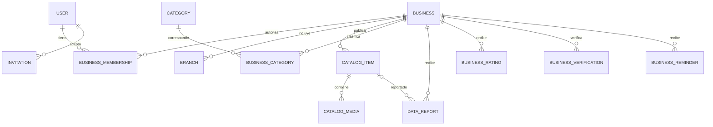

# 06. Modelo de datos conceptual

> **Producto:** PorAquí · **Empresa:** NextWare  
> **Estado:** Borrador para revisión · **Responsable propuesto:** Backend / datos  
> **Versión:** 0.1 · **Actualizado:** 2026-10-24 · **Cobertura:** Santiago Ixcuintla, Nayarit  
> **Nota:** El esquema sigue siendo conceptual y requiere validación antes de implementar; `20_politica_calificaciones_moderacion.md` recoge decisiones de base ratificadas por el líder del proyecto y `21_politica_ranking_destacados_analitica.md` acuerdos de equipo sobre ranking y temas relacionados.

## Estado
Esquema conceptual **por validar**. No representa tablas ni migraciones aprobadas. Separa entidades del MVP de módulos futuros.

## Modelo de dominio mínimo

## Entidades y campos esenciales
| Entidad | Campos base (propuesta) | Restricciones/observaciones |
|---|---|---|
| `users` | id, proveedor_identidad_id, nombre_mostrado, email/teléfono verificado, estado | Evitar secretos en tablas de dominio. |
| `businesses` | id, nombre, slug, descripción, estado_publicación, última_confirmación | Slug único por ámbito definido; historia de cambios. |
| `branches` | id, negocio_id, dirección, localidad, lat/lon opcionales, horarios, contacto | Varias sucursales si negocio lo requiere; no inventar coordenadas. |
| `business_memberships` | usuario_id, negocio_id, rol, estado | Índice y restricción de unicidad por membresía activa. |
| `categories` | id, nombre, parent_id opcional, tipo | Taxonomía adaptable a productos y servicios. |
| `business_categories` | negocio_id, categoria_id | Evitar categorías duplicadas. |
| `catalog_items` | id, negocio_id, tipo, nombre, slug, descripción, precio opcional, moneda, estado_publicación, estado_disponibilidad, confirmado_en | `tipo`: producto/servicio; no inferir stock. |
| `catalog_media` | id, item_id, object_key, mime, ancho, alto, orden, alt_text | Fotos fuera de la BD. |
| `business_verifications` | id, negocio_id, admin_id, tipo_evidencia, estado, fecha | Evidencia privada con retención definida. |
| `invitations` | id, negocio_id, contacto_destino, token_hash, expiración, uso, creado_por | Nunca almacenar token de invitación en claro. |
| `data_reports` | id, negocio_id, item_id opcional, motivo, detalle, estado, fecha, resuelto_por | Historial y antiabuso. |
| `business_ratings` | id, negocio_id, usuario_id, puntuación, estado_moderación, creada_en, actualizada_en | Una calificación vigente por cuenta y negocio; 1–5 estrellas; sin comentario en MVP. Aplicar restricción única, proteger datos personales y auditar ediciones. |
| `rating_moderation_events` | id, negocio_id, rating_id opcional, tipo, ventana_inicio, ventana_fin, estado, revisado_por, resuelto_en, apelar_hasta, eliminar_o_anonimizar_en | Propuesta conceptual para registrar reportes/señales, revisión humana, ocultamiento provisional individual y apelación. No hay umbrales automáticos ni retención de 12 meses ratificados; definir permisos y plazos antes de implementar. No borrar calificaciones ni despublicar el negocio automáticamente por volumen. |
| `featured_placements` | id, recurso_tipo, recurso_id, categoría_id opcional, zona_id opcional, origen, motivo, inicio, fin, estado | Selección manual solo entre candidatos elegibles/pertinentes; registrar motivo, origen y periodo. Separar de resultados orgánicos; sin compra de posiciones en el MVP. Los detalles de acceso/revisión siguen por definir. |
| `business_reminders` | id, negocio_id, canal, vence_en, enviado_en, estado | Idempotencia y preferencias. |
| `events_aggregated` | tipo, recurso_id?, período, total | Medir búsquedas/vistas/contactos e impresiones agregadas sin perfiles persistentes de visitantes; la ventana y granularidad se definen tras el piloto y revisión de privacidad. |

## Enumeraciones propuestas
- Publicación negocio: `draft`, `pending_review`, `published`, `suspended`, `closed_confirmed`.
- Publicación ítem: `draft`, `published`, `unpublished`.
- Disponibilidad: `unknown`, `available_confirmed`, `temporarily_out`, `discontinued`.
- Reporte: `new`, `under_review`, `awaiting_merchant`, `resolved_confirmed`, `rejected`, `closed_duplicate`.
- Invitación: `pending`, `accepted`, `expired`, `revoked`.

## Reglas de integridad
Índices en nombre/slug/categoría; búsquedas de texto según diseño aprobado; coordenadas válidas y geometría geográfica; integridad de pertenencia entre ítem y negocio; despublicar sin eliminar indiscriminadamente datos auditables; unicidad de URL; transacciones para asignaciones de permisos y aprobaciones.

## Seguridad del modelo
Separación entre vistas públicas y tablas internas; no exponer teléfonos privados distintos al contacto comercial autorizado; RLS si se elige base gestionada compatible; respaldos cifrados; IDs no equivalen a permisos.

El promedio y el conteo públicos se calculan solo con calificaciones visibles. La identidad del calificador y los detalles de moderación no son públicos; solo cuentas asociadas a un contacto verificado pueden calificar (elegibilidad ratificada por el líder del proyecto). Reportes/señales no cambian el estado público automáticamente; un moderador autorizado puede ocultar provisionalmente una calificación solo después de revisión humana. Véase `20_politica_calificaciones_moderacion.md`.

## Evolución futura — NO desplegar en el MVP
Campañas de publicidad pagada, `booking`, reservas, inventario POS, `inventory_sync_event`, pedidos y repartos, datos de interés publicitario y un proveedor OIDC multiaplicación. Documentar en migraciones futuras por separado.

## Pendientes
Definición de múltiples sucursales MVP, modelo exacto de servicios vs productos, diccionario de categorías, búsquedas por variantes y sinónimos, retención de evidencias, separación de precios por sucursal.
