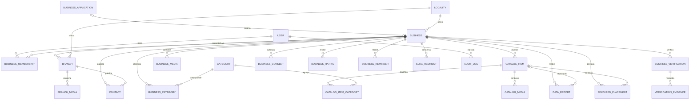

# 06. Modelo de datos conceptual (v0.4 propuesta con acuerdos de equipo parciales)

> **Producto:** PorAquí · **Empresa:** NextWare
> **Tarea:** [Actualizar modelo de datos con las decisiones ratificadas](https://app.clickup.com/t/86bcwrwhw)
> **Fuente preservada:** `06_modelo_datos_v0.3.md`, adjunto de la tarea [86bcqtu76](https://app.clickup.com/t/86bcqtu76); no se modifica.
> **Estado:** Propuesta conceptual no aprobada en conjunto; incorpora acuerdos explícitos del equipo y decisiones de base ratificadas por el líder en la política 20. Las demás propuestas siguen pendientes de ratificación.
> **Versión:** 0.4 · **Base:** `06_modelo_datos_v0.3.md` (v0.3 original conservada)
> **Documento de análisis:** `REVISION_06_modelo_datos.md` (referencia de la fuente; no actualizado en esta tarea)
> **Nota:** Modelo conceptual. No representa tablas, migraciones ni código aprobado; no está listo para implementación.

## 0. Estado de ratificación

La transferencia de propuestas de v0.3 a esta versión no las convierte en acuerdos. Solo se consideran ratificadas las reglas descritas en **Acuerdos del equipo** en la sección 4.16 (ClickUp 86bcwrwhg) y las decisiones de base atribuidas al líder en la política 20. Los campos y reglas restantes siguen siendo propuestas o pendientes.

**Acuerdos del equipo para calificaciones (86bcwrwhg):**

- Solo una cuenta autenticada asociada a un contacto verificado puede enviar una calificación; el proveedor y el canal de verificación no están seleccionados.
- Una anomalía o un pico de volumen no pausa automáticamente nuevas calificaciones.
- Tras revisión humana, un moderador autorizado puede ocultar provisionalmente una calificación individual, registrando motivo y auditoría.
- Si se oculta una calificación, el aviso y la apelación son privados; se permite apelar dentro de 30 días. La validación legal/documental de este plazo sigue pendiente.
- Restaurar la calificación salvo que exista una infracción documentada.

**Decisiones de base ratificadas por el líder del proyecto ([política 20](20_politica_calificaciones_moderacion.md)):**

- Un pico o reporte aislado no borra calificaciones ni despublica el negocio automáticamente.
- Mostrar promedio y conteo agregados de calificaciones visibles; excluir las ocultas provisionalmente y no exponer identidad del autor ni detalles internos de moderación.

**Pendiente de ratificación o validación:**

- Taxonomía de categorías/subcategorías y aprobación de la estructura jerárquica; `parent_id` sigue siendo una propuesta conceptual.
- Proveedor de identidad, métodos de alta/invitación/autenticación, canales de verificación e identificadores únicos; solo el requisito general de contacto verificado para calificar está acordado.
- Formato de calificación, comentarios, unicidad/duplicados, edición/borrado, exclusiones de elegibilidad (por ejemplo, autoría o membresía), estados y flujo de publicación, filtros automáticos, ventanas, umbrales y límites; el alias público tampoco está ratificado.
- Retención, eliminación/anonimización y validaciones legales/de privacidad. No se ratifican los plazos propuestos en v0.3.

## 1. Cómo leer este documento

| Marca | Significado |
|---|---|
| **Documentado** | Ya aparece en `06_modelo_datos.md` v0.1; se conserva. |
| **Resuelto en propuesta** | Recomendación, no aprobación; requiere ratificación explícita del equipo. Véase el estado de v0.4 en la sección 0. |
| **Pendiente** | No se decide aquí; queda en `DECISIONES_PENDIENTES.md`. |
| **Futuro** | Fuera del MVP; no se implementa ahora. |

### Propuestas contenidas en v0.3 y conservadas sin ratificar

Las siguientes definiciones se mantienen como propuesta conceptual; no constituyen acuerdos aprobados en v0.4 salvo las reglas específicas de calificaciones señaladas en la sección 0:

1. `catalog_items` conserva `precio`, `moneda`, `estado_disponibilidad` y `confirmado_en`.
2. `branches` se mantiene como entidad separada. Se permiten **varias sucursales** para ubicación y contacto.
3. El catálogo, el precio y la disponibilidad son **globales del negocio**, no de la sucursal. No se introduce `catalog_offers`.
4. El precio por sucursal, el stock numérico y las ofertas por sucursal quedan fuera del MVP.
5. Captación, publicación y verificación se modelan como **tres ciclos separados**.
6. Se incorporan relación ítem-categoría, consentimientos, contactos, historial de slugs y auditoría.
7. v0.3 propuso calificaciones con puntuación + comentario y correo verificado; el formato y el canal de identidad no están ratificados. Solo aplican las reglas explícitas de la sección 0.
8. La cobertura del MVP es **Santiago Ixcuintla, Nayarit**; no se promete catálogo completo ni multi-ciudad.
9. v0.3 propuso alta de comerciantes por invitación y cuenta de visitante con correo + contraseña; los métodos de registro y autenticación siguen pendientes de ratificación.
10. Solo se publica **contacto comercial autorizado**; los datos personales quedan privados.
11. v0.3 propuso umbrales de vigencia **30/60/90** y frescura derivada; estos valores no están ratificados y requieren validación/piloto.
12. v0.3 propuso retención de **12/24 meses**; estos plazos no están aprobados y requieren validación legal y de privacidad.
13. v0.3 afirmaba que no había decisiones P0 abiertas; esa clasificación no equivale a ratificación del modelo ni de sus propuestas.

## 2. Principios del modelo

1. **Un dato, una finalidad.** No mezclar captación, publicación y verificación.
2. **Producto/servicio no es stock.** El tipo describe qué se ofrece; la disponibilidad describe qué se afirma; el stock numérico no existe en el MVP.
3. **El catálogo es global.** Las sucursales describen presencia física o área de servicio; no crean precios ni disponibilidad paralela.
4. **Lo público se deriva de lo interno.** Las vistas públicas solo exponen datos publicados y autorizados.
5. **Integridad explícita.** Pertenencia por FK, no por convención.
6. **Historial sin duplicar la verdad.** Los estados actuales viven en la entidad; los cambios se auditan.
7. **Privacidad por diseño.** Evidencia, contactos privados, reportes, calificaciones y auditoría no se mezclan con el catálogo público.
8. **Evolución sin romper URL.** Slugs e identificadores públicos tienen reglas de estabilidad y redirección.
9. **Consentimiento antes de publicar.** La ficha, las fotos y los contactos públicos requieren autorización trazable.

## 3. Diagrama del modelo MVP propuesto



## 4. Entidades y campos

### 4.1 `users` — Esquema propuesto; identidad pendiente de ratificación

**Estatus v0.4:** proveedor, método de alta/autenticación, canal de verificación y unicidad de identificadores no están aprobados. El requisito ratificado es únicamente que una calificación provenga de una cuenta autenticada asociada a un contacto verificado; su implementación queda pendiente.

| Campo | Tipo conceptual | Regla |
|---|---|---|
| `id` | UUID/opaco | PK |
| `identity_provider` | enum | Propuesta `email_password`; proveedor/método no ratificado |
| `identity_provider_id` | texto | Propuesta; unicidad y proveedor pendientes; nunca exponer |
| `display_name` | texto | Público solo si el rol lo permite |
| `email` | texto | Privado; unicidad y normalización pendientes de ratificación |
| `email_verified_at` | timestamp nullable | Campo propuesto; el canal/implementación de contacto verificado sigue pendiente |
| `phone` | texto | Campo propuesto; privado; unicidad y uso como contacto pendientes |
| `status` | enum | Propuesta; estados y regla de verificación pendientes |
| `last_login_at` | timestamp nullable | Operativo |
| `created_at`, `updated_at` | timestamp | UTC |

**Reglas:**

- Buscar, consultar fichas y contactar no requiere cuenta.
- Para calificar, la cuenta debe estar autenticada y asociada a un contacto verificado. El proveedor, el canal y el campo persistido para esa verificación siguen pendientes.
- El alta por correo + contraseña y la unicidad por correo son propuestas de v0.3, no decisiones ratificadas.
- v0.3 propuso que los comerciantes reciban invitación y acepten una cuenta existente o nueva; este flujo de alta permanece pendiente de ratificación.
- La cuenta de visitante no otorga permisos sobre ningún negocio.
- No guardar contraseñas ni tokens de proveedor en tablas de dominio; el proveedor de identidad conserva el hash y los factores.
- `email_verified_at` no se expone públicamente.

### 4.2 `businesses` — Documentado + resuelto

| Campo | Tipo conceptual | Regla |
|---|---|---|
| `id` | UUID/opaco | PK |
| `name` | texto | Nombre comercial |
| `slug` | texto | Único case-insensitive; estable |
| `description` | texto | Público si está publicado |
| `publication_status` | enum | `draft`, `pending_review`, `published`, `suspended`, `closed_confirmed` |
| `ultima_confirmacion` | timestamp | Última confirmación de la ficha; no cambia ítems |
| `locality_id` | FK | Localidad normalizada |
| `service_area` | texto/geometría nullable | Para negocios sin local físico |
| `created_at`, `updated_at` | timestamp | UTC |
| `published_at` | timestamp | Solo si aplica |
| `suspended_reason` | texto | Privado/administrativo |

**Regla:** `publication_status` no contiene estados de captación ni de verificación. La verificación vigente se deriva de `business_verifications`; si vence, el sistema mueve la publicación a `suspended` con motivo `verification_expired` y lo audita.

### 4.3 `business_applications` — Resuelto en propuesta

| Campo | Tipo conceptual | Regla |
|---|---|---|
| `id` | UUID/opaco | PK |
| `business_name` | texto | Nombre preliminar |
| `contact_name` | texto | Privado |
| `contact_channel` | texto | WhatsApp/teléfono/email |
| `locality_id` | FK | Zona de captación |
| `category_hint` | texto/FK | Categoría preliminar |
| `stage` | enum | `contacted`, `interested`, `pending_evidence`, `approved`, `rejected`, `invited`, `activated`, `inactive`, `follow_up` |
| `source` | enum | `visit`, `whatsapp`, `referral`, `other` |
| `assigned_to` | FK `users` | Responsable |
| `business_id` | FK nullable | Se llena al crear la ficha |
| `rejection_reason` | texto | Privado |
| `notes` | texto | Privado |
| `created_at`, `updated_at` | timestamp | UTC |

**Regla:** el onboarding no cambia `businesses.publication_status` directamente. `published` no es un estado de solicitud; `activated` no implica publicación.

### 4.4 `branches` — Documentado + resuelto

| Campo | Tipo conceptual | Regla |
|---|---|---|
| `id` | UUID/opaco | PK |
| `business_id` | FK | Pertenencia |
| `name` | texto | Etiqueta de sucursal |
| `slug` | texto | Único por negocio |
| `address` | texto | Público si autorizado |
| `locality_id` | FK | Localidad normalizada |
| `lat`, `lon` | decimal nullable | Ambas o ninguna |
| `schedule` | JSON/texto | Horario público |
| `status` | enum | `active`, `inactive`, `closed` |
| `is_primary` | boolean | Una principal por negocio |
| `service_area` | texto/geometría nullable | Para sucursales sin atención en local |
| `created_at`, `updated_at` | timestamp | UTC |

**Reglas:**

- Un negocio puede tener varias sucursales.
- Un negocio publicado debe tener al menos una sucursal `active` o un `service_area` declarado.
- Como máximo una sucursal principal por negocio.
- `catalog_items` no tiene `branch_id`: precio y disponibilidad son globales en el MVP.
- La UI no debe prometer precio, stock ni disponibilidad por sucursal.

### 4.5 `business_memberships` — Documentado + resuelto

| Campo | Tipo conceptual | Regla |
|---|---|---|
| `id` | UUID | PK |
| `user_id` | FK | Usuario |
| `business_id` | FK | Negocio |
| `role` | enum | `owner`, `admin`, `editor` |
| `status` | enum | `invited`, `active`, `revoked` |
| `invited_by` | FK nullable | Quién invitó |
| `accepted_at` | timestamp | Aceptación |
| `revoked_at` | timestamp | Revocación |
| `created_at`, `updated_at` | timestamp | UTC |

**Invariantes:** una membresía activa por usuario/negocio; al menos un `owner` activo; el último owner no se revoca sin transferencia o intervención administrativa auditada.

### 4.6 `invitations` — Documentado + resuelto

| Campo | Tipo conceptual | Regla |
|---|---|---|
| `id` | UUID | PK |
| `business_id` | FK | Negocio |
| `contact_type` | enum | `email`, `phone` |
| `contact_value` | texto | Normalizado; privado |
| `role` | enum | Rol a otorgar |
| `token_hash` | texto | Único; nunca token en claro |
| `status` | enum | `pending`, `accepted`, `expired`, `revoked` |
| `expires_at` | timestamp | Obligatorio |
| `sent_at`, `accepted_at`, `used_at` | timestamp | Trazabilidad |
| `used_by` | FK nullable | Usuario que aceptó |
| `created_by` | FK | Administrador |
| `attempts` | entero | Antiabuso |

### 4.7 `categories` — Estructura conceptual; taxonomía pendiente

**Estatus v0.4:** no se encontró una taxonomía ni una jerarquía de categorías/subcategorías ratificada por el equipo. `parent_id` y las reglas de árbol se conservan como propuesta de v0.3, no como decisión aprobada.

| Campo | Tipo conceptual | Regla |
|---|---|---|
| `id` | UUID | PK |
| `name` | texto | Visible |
| `slug` | texto | Único por `kind`/padre |
| `parent_id` | FK nullable | Sin ciclos |
| `kind` | enum | `business`, `item`, `both` |
| `status` | enum | `active`, `deprecated` |

**Regla:** una categoría usada no se elimina; se deprecia o fusiona con redirección. El árbol no puede tener ciclos.

### 4.8 `business_categories` y `catalog_item_categories` — Resuelto en propuesta

`business_categories` — Documentado:

| Campo | Regla |
|---|---|
| `business_id` | FK |
| `category_id` | FK |
| `is_primary` | Una principal por negocio |

`catalog_item_categories` — Resuelto:

| Campo | Regla |
|---|---|
| `catalog_item_id` | FK |
| `category_id` | FK |
| `is_primary` | Una principal por ítem |

**Reglas:**

- Todo ítem publicado debe tener al menos una categoría.
- Como máximo una categoría principal por ítem.
- La categoría debe ser `active` y de `kind` `item` o `both`.
- Si una categoría se fusiona, las relaciones se migran y el slug antiguo redirige.

### 4.9 `catalog_items` — Documentado + resuelto

Se conservan los campos documentados `precio`, `moneda`, `estado_disponibilidad` y `confirmado_en`. Los nombres restantes son conceptuales; la migración definirá el naming final.

| Campo | Tipo conceptual | Regla |
|---|---|---|
| `id` | UUID/opaco | PK |
| `negocio_id` | FK | Pertenencia |
| `tipo` | enum | `producto`, `servicio` |
| `nombre` | texto | Público |
| `slug` | texto | Único por negocio; estable |
| `descripcion` | texto | Público |
| `precio` | `numeric(12,2)` nullable | Documentado; sin `float` |
| `precio_max` | `numeric(12,2)` nullable | Solo rango |
| `moneda` | char(3) | Documentado; ISO 4217; obligatoria si hay precio |
| `tipo_precio` | enum | `fijo`, `desde`, `rango`, `cotizar` |
| `estado_publicacion` | enum | `draft`, `published`, `unpublished`, `archived` |
| `estado_moderacion` | enum | `clear`, `under_review`, `blocked` |
| `estado_disponibilidad` | enum | `unknown`, `available_confirmed`, `temporarily_out`, `discontinued` |
| `confirmado_en` | timestamp nullable | Documentado; obligatorio para `available_confirmed` |
| `fuente_disponibilidad` | enum | `comerciante`, `admin`, `reporte`, `importacion` |
| `nota_disponibilidad` | texto nullable | Público si se autoriza |
| `creado_en`, `actualizado_en` | timestamp | UTC |
| `creado_por`, `actualizado_por` | FK | Trazabilidad |

**No incluye:** `branch_id`, `stock_quantity`, `reserved_quantity`, SKU, variantes, almacenes ni `catalog_offers`.

**Reglas de precio:**

- `tipo_precio = fijo` exige `precio` y prohíbe `precio_max`.
- `tipo_precio = desde` exige `precio`; el texto público es “Desde”.
- `tipo_precio = rango` exige `precio` y `precio_max`, con máximo ≥ mínimo.
- `tipo_precio = cotizar` prohíbe importes y muestra “Cotizar”.
- Sin precio: `tipo_precio = cotizar`; nunca mostrar `$0`.
- No usar `float`.

**Reglas de disponibilidad:**

- `unknown` se muestra “Consultar existencia”; nunca “Disponible”.
- `available_confirmed` exige `confirmado_en` y `fuente_disponibilidad`.
- `temporarily_out` sigue publicado; se oculta por defecto en filtros, pero el enlace directo informa.
- `discontinued` se retira de búsquedas activas y se conserva para historial.
- `estado_moderacion = blocked` oculta el ítem aunque esté publicado; solo un administrador lo retira y la decisión se audita.
- Cambiar `estado_publicacion` no cambia `estado_disponibilidad`, y viceversa.
- `confirmado_en` confirma disponibilidad del ítem; no confirma la ficha del negocio.

**Frescura derivada (30/60/90):**

| Antigüedad de `confirmado_en` | Frescura | Presentación |
|---|---|---|
| 0–30 días | `fresh` | Estado confirmado; “Disponible” si corresponde |
| 31–60 días | `stale` | Estado visible con advertencia de actualización |
| Más de 60 días | `unknown` | “Consultar existencia”; nunca “Disponible” |

- La frescura se calcula; no se guarda ni reescribe `estado_disponibilidad` por el paso del tiempo.
- La ficha del negocio se marca para revisión a los 90 días desde `ultima_confirmacion`.
- La antigüedad no despublica automáticamente; la verificación vencida sí puede suspender.
- “Todo sigue igual” actualiza `ultima_confirmacion` del negocio, no `confirmado_en` de los ítems.

### 4.10 `catalog_media`, `business_media` y `branch_media` — Resuelto en propuesta

Estructura común:

| Campo | Regla |
|---|---|
| `id` | PK |
| `catalog_item_id` / `business_id` / `branch_id` | Un solo propietario explícito |
| `object_key` | Único; privado |
| `mime` | Validado |
| `width`, `height` | Metadatos |
| `size_bytes` | Límite técnico |
| `checksum` | Integridad |
| `sort_order` | Único por propietario |
| `alt_text` | Accesibilidad |
| `is_primary` | Una por propietario |
| `status` | `pending`, `ready`, `rejected` |
| `created_at` | UTC |
| `deleted_at` | Borrado controlado |

**Reglas:** no hay propietario polimórfico; una imagen principal por propietario; se eliminan huérfanos; se retiran metadatos EXIF privados; los originales y object keys no se exponen.

### 4.11 `business_verifications` — Documentado + resuelto

| Campo | Tipo conceptual | Regla |
|---|---|---|
| `id` | UUID | PK |
| `business_id` | FK | Negocio |
| `method` | enum | `visit`, `call`, `document`, `other` |
| `status` | enum | `pending`, `verified`, `rejected`, `expired` |
| `verified_by` | FK `users` | Administrador |
| `verified_at` | timestamp | Fecha |
| `expires_at` | timestamp | Reverificación |
| `rejection_reason` | texto | Privado |
| `created_at` | timestamp | UTC |

**Regla:** verificar existencia no equivale a autorizar publicación; el consentimiento es una entidad aparte.

### 4.12 `verification_evidence` — Resuelto en propuesta

| Campo | Tipo conceptual | Regla |
|---|---|---|
| `id` | UUID | PK |
| `business_id` | FK | Negocio |
| `verification_id` | FK | Verificación |
| `object_key` | texto | Privado |
| `mime`, `size_bytes`, `checksum` | varios | Validación |
| `uploaded_by` | FK | Responsable |
| `retention_until` | timestamp | 12 meses propuestos en v0.3 tras fin/rechazo; plazo y regla pendientes de validación legal/de privacidad (DP-08) |
| `deleted_at` | timestamp | Borrado controlado |

### 4.13 `business_consents` — Resuelto en propuesta

| Campo | Tipo conceptual | Regla |
|---|---|---|
| `id` | UUID | PK |
| `business_id` | FK | Negocio |
| `type` | enum | `publish_profile`, `publish_photos`, `publish_contact`, `terms`, `privacy` |
| `granted_by` | texto/FK | Representante |
| `granted_at` | timestamp | Fecha |
| `expires_at` | timestamp nullable | Vigencia |
| `revoked_at` | timestamp nullable | Revocación |
| `evidence_id` | FK nullable | Evidencia |
| `version` | texto | Versión del texto aceptado |

**Reglas:**

- Sin `publish_profile` vigente no se publica la ficha.
- Sin `publish_photos` vigente no se publican fotos.
- Sin `publish_contact` vigente no se publican contactos comerciales.
- La revocación oculta los campos afectados de inmediato y se audita.
- La ficha puede existir en borrador sin consentimiento de publicación.

### 4.14 `contacts` — Resuelto en propuesta

| Campo | Tipo conceptual | Regla |
|---|---|---|
| `id` | UUID | PK |
| `business_id` | FK nullable | Propietario |
| `branch_id` | FK nullable | Propietario |
| `type` | enum | `phone`, `whatsapp`, `email`, `social` |
| `value` | texto | Normalizado |
| `visibility` | enum | `public`, `private` |
| `is_primary` | boolean | Uno por tipo/propietario |
| `verified_at` | timestamp | Verificación |
| `consent_id` | FK nullable | Autorización |
| `created_at`, `updated_at` | timestamp | UTC |

**Reglas:** exactamente uno de `business_id` o `branch_id`; un principal por tipo/propietario; un contacto `public` exige `visibility = public`, ser comercial y tener consentimiento `publish_contact` vigente; los privados nunca salen en API pública. Teléfonos y correos personales no se publican por defecto; al revocar el consentimiento se retiran de inmediato.

### 4.15 `data_reports` — Documentado + resuelto

| Campo | Tipo conceptual | Regla |
|---|---|---|
| `id` | UUID | PK |
| `business_id` | FK | Negocio |
| `catalog_item_id` | FK nullable | Debe pertenecer al negocio |
| `branch_id` | FK nullable | Sucursal afectada |
| `reason` | enum/texto | Motivo |
| `details` | texto | Privado |
| `status` | enum | `new`, `under_review`, `awaiting_merchant`, `resolved_confirmed`, `rejected`, `closed_duplicate` |
| `reporter_ref` | texto | Seudónimo/antiabuso; no PII pública |
| `created_at`, `updated_at` | timestamp | UTC |
| `resolved_by` | FK nullable | Administrador |
| `resolved_at` | timestamp | Fecha |
| `resolution_note` | texto | Privado |
| `duplicate_of_id` | FK nullable | Duplicado |

**Invariante:** `(business_id, catalog_item_id)` debe existir en `catalog_items (business_id, id)` cuando `catalog_item_id` no es nulo. Cada transición se registra con actor, fecha y nota.

### 4.16 `business_ratings` — Acuerdo parcial de equipo; esquema restante propuesto

**Estatus v0.4:** la tabla y sus campos son conceptuales y no están aprobados como esquema. Solo las reglas de los bloques **Acuerdos del equipo ratificados** y **Base ratificada por el líder** son decisiones explícitas; el formato, los estados y las demás reglas conservan carácter de propuesta.

| Campo | Tipo conceptual | Regla |
|---|---|---|
| `id` | UUID | PK |
| `business_id` | FK | Negocio |
| `user_id` | FK | Autor; privado |
| `score` | entero | 1–5, obligatorio |
| `comment` | texto nullable | Habilitado; máximo 1.000 caracteres |
| `status` | enum | `pending`, `published`, `hidden`, `rejected` |
| `display_alias` | texto | Propuesta no ratificada; la representación pública exacta sigue pendiente y no debe exponer identidad |
| `pseudonymous_id` | texto | Interno; no se expone en API pública |
| `created_at`, `updated_at` | timestamp | UTC |
| `moderated_by`, `moderated_at` | FK/timestamp | Trazabilidad |
| `moderation_reason` | texto | Privado |

**Acuerdos del equipo ratificados (ClickUp 86bcwrwhg):**

- Para enviar una calificación se requiere una cuenta autenticada asociada a un contacto verificado; no se ratificó proveedor, canal ni campo de almacenamiento.
- Un pico o señal de anomalía requiere revisión humana; no pausa automáticamente nuevas calificaciones.
- Solo un moderador autorizado, después de revisión humana, puede ocultar provisionalmente una calificación individual, con motivo y auditoría.
- El aviso al autor y la apelación son privados; se permite apelar dentro de 30 días. La validación legal/documental del plazo sigue pendiente.
- Restaurar salvo que exista una infracción documentada.

**Base ratificada por el líder del proyecto ([política 20](20_politica_calificaciones_moderacion.md)):**

- Mostrar promedio y conteo agregados de calificaciones visibles; excluir las ocultas provisionalmente y no exponer identidad del autor ni detalles internos de moderación.
- Un pico o reporte aislado no borra calificaciones ni despublica el negocio automáticamente.

**Reglas de la propuesta v0.3 aún no ratificadas:**

- Navegar, buscar y contactar no requiere cuenta; calificar y comentar sí.
- El estado de cuenta requerido, la unicidad por identificador y el uso de correo como canal único siguen pendientes; el registro por email/contraseña es una propuesta no ratificada.
- Solo un negocio `published` puede recibir calificaciones.
- Un usuario no puede calificar su propio negocio ni uno del que es miembro activo.
- Una calificación activa por usuario/negocio.
- La puntuación es obligatoria; el comentario está habilitado y es opcional.
- Solo las calificaciones `published` son públicas; las demás no se muestran.
- El autor se muestra con alias o “Usuario de PorAquí”; nunca email, teléfono ni `user_id`.
- El negocio no puede editar ni borrar calificaciones; puede reportarlas.
- El autor puede editar o borrar su calificación; el borrado se conserva para auditoría.
- Al cerrar o suspender el negocio, sus calificaciones se ocultan de la vista pública pero no se borran.

**Detección y automatización — propuesta no ratificada:**

- La publicación automática y los filtros para marcar una calificación `pending` son propuestas de v0.3, no reglas aprobadas.
- Los filtros, límites por cuenta/IP, duplicados, longitud máxima, enlaces y criterios de contenido abusivo requieren decisión posterior.
- No hay umbrales numéricos ni ventanas ratificadas. No limitar temporalmente la entrada por volumen; calibrar cualquier regla futura con datos del piloto y aprobación explícita.
- El negocio puede reportar; el autor puede impugnar; administración puede ocultar, rechazar o restaurar con motivo auditado.
- Cualquier umbral futuro, su configuración y su efecto operativo requieren decisión explícita; el volumen no es prueba automática de culpa.

### 4.17 `rating_moderation_events` — Documentado + resuelto

| Campo | Regla |
|---|---|
| `id` | PK |
| `business_id` | FK |
| `type` | `spike`, `abuse`, `manual` |
| `window_start`, `window_end` | Ventana |
| `status` | Estado |
| `reviewed_by` | Administrador |
| `resolved_at` | Fecha |
| `notes` | Privado |

### 4.18 `featured_placements` — Documentado + resuelto

| Campo | Tipo conceptual | Regla |
|---|---|---|
| `id` | UUID | PK |
| `business_id` | FK nullable | Objetivo |
| `catalog_item_id` | FK nullable | Objetivo alternativo |
| `locality_id` | FK nullable | Localidad |
| `zone_id` | FK nullable | Zona; como máximo una de `locality_id`/`zone_id` |
| `category_id` | FK nullable | Categoría |
| `source` | enum | `manual`, `rule` |
| `starts_at`, `ends_at` | timestamp | Vigencia |
| `status` | enum | `scheduled`, `active`, `ended`, `cancelled` |
| `reason` | texto | Justificación |
| `created_by` | FK | Administrador |

**Regla:** exactamente uno de `business_id` o `catalog_item_id`; como máximo una de `locality_id`/`zone_id`; no hay compra de posiciones en el MVP.

### 4.19 `business_reminders` — Documentado + resuelto

| Campo | Tipo conceptual | Regla |
|---|---|---|
| `id` | UUID | PK |
| `business_id` | FK | Negocio |
| `type` | enum | `validity_review`, `report_followup`, `onboarding` |
| `channel` | enum | `email`, `whatsapp`, `in_app` |
| `due_at` | timestamp | Vencimiento |
| `sent_at` | timestamp nullable | Envío |
| `status` | enum | `pending`, `sent`, `failed`, `cancelled` |
| `idempotency_key` | texto | Único |
| `attempts` | entero | Reintentos |
| `last_error` | texto | Privado |

### 4.20 `notification_preferences` — Resuelto en propuesta

`user_id`, `business_id`, `channel`, `opt_in`, `updated_at`. Se separa del recordatorio para no duplicar preferencias.

### 4.21 `events_aggregated` — Documentado + resuelto

| Campo | Regla |
|---|---|
| `type` | Tipo de evento |
| `business_id`, `catalog_item_id`, `locality_id` | Dimensiones opcionales |
| `period_start`, `period_end` | Período |
| `count` | Agregado |

**Regla:** único por tipo/período/dimensiones; sin datos personales crudos.

### 4.22 `localities` y `zones` — Resuelto en propuesta

`localities`: `id`, `name`, `state`, `country`, `slug`, `lat`, `lon`, `status`.
`zones`: `id`, `locality_id`, `name`, `slug`, `geometry` opcional.

**Alcance MVP:** `localities` es suficiente para filtros por localidad; `zones` queda para P1/P2 según DP-26. `featured_placements` usa `locality_id` o `zone_id` explícito, nunca un `zona_id` huérfano.

### 4.23 `slug_redirects` — Resuelto en propuesta

| Campo | Regla |
|---|---|
| `id` | PK |
| `entity_type` | `business`, `catalog_item`, `category` |
| `entity_id` | FK lógica |
| `old_slug` | Único por tipo |
| `created_at` | Fecha |

**Reglas:** el slug actual vive en la entidad; los antiguos redirigen 301/equivalente; no se reutilizan; no se permiten cadenas ni ciclos de redirección.

### 4.24 `audit_log` — Resuelto en propuesta

| Campo | Regla |
|---|---|
| `id` | PK |
| `actor_user_id` | FK nullable (sistema) |
| `action` | Verbo |
| `entity_type`, `entity_id` | Objeto |
| `before`, `after` | JSON redactado |
| `reason` | Motivo |
| `request_id` | Correlación |
| `created_at` | UTC, append-only |

**Regla:** no guardar PII innecesaria; redactar secretos y evidencia.

### 4.25 Alcance, catálogo y registro

- **Cobertura:** Santiago Ixcuintla, Nayarit. No hay multi-ciudad ni promesa de cobertura nacional.
- **Catálogo:** se promete catálogo publicado por negocios verificados, no “catálogo completo”. Los límites son técnicos y antiabuso, no comerciales.
- **Contacto:** solo comercial autorizado; los datos personales del representante quedan privados.
- **Comerciantes:** v0.3 propuso alta por invitación y ausencia de autoservicio; el método permanece pendiente de ratificación.
- **Visitantes:** navegación anónima. v0.3 propuso registro con correo + contraseña y verificación de correo para calificar/comentar, pero ese método y canal no están ratificados; el único requisito aprobado es contacto verificado para calificar.

## 5. Ciclos de vida

### 5.1 Negocio: tres ciclos separados

```text
Captación / onboarding (business_applications.stage)
contacted → interested → pending_evidence → approved → invited → activated
                                      ↘ rejected
                     inactive ↔ follow_up
Publicación (businesses.publication_status)
draft → pending_review → published → suspended → closed_confirmed
                         ↑                ↓
                         └──── published ─┘
Verificación (business_verifications.status)
pending → verified → expired
        ↘ rejected
```

**Equivalencias con `16`:**

| Estado en `16` | Dónde vive |
|---|---|
| `contacted`, `interested`, `pending_evidence` | `business_applications.stage` |
| `approved`, `rejected`, `invited`, `activated`, `inactive`, `follow_up` | `business_applications.stage` |
| `published` | `businesses.publication_status`; la solicitud sigue `activated` |

**Reglas de transición:**

- `approved` no publica automáticamente.
- v0.3 propuso que `invited` requiera una invitación válida y que `activated` siga a la aceptación; este flujo continúa pendiente de ratificación.
- `published` exige: solicitud `activated`, verificación `verified`, consentimiento `publish_profile` vigente, al menos un contacto público autorizado y al menos una sucursal `active` o `service_area`.
- `suspended` oculta ficha y catálogo, pero conserva datos; puede volver a `published` si se resuelve el motivo.
- `closed_confirmed` retira de búsquedas y no borra; es terminal.
- `inactive` y `follow_up` son operativos; no son estados de publicación.
- La verificación `expired` mueve la publicación a `suspended` con motivo `verification_expired`; no borra el negocio.
- Toda transición crítica registra actor, fecha, motivo y `audit_log`.

### 5.2 Ítem

```text
Publicación
draft → published → unpublished → archived
Disponibilidad
unknown → available_confirmed → temporarily_out → discontinued
```

**Reglas:**

- Solo un ítem `published`, con moderación `clear`, de un negocio `published`, es visible.
- Todo ítem publicado tiene al menos una categoría y una categoría principal.
- `unpublished` no visible; `archived` conserva historial.
- `temporarily_out` visible por enlace directo, oculto en filtros por defecto.
- `discontinued` no visible en búsquedas activas; conserva enlace con aviso o redirección.
- `blocked` oculta aunque esté publicado; no se pierde si el comerciante republica.
- Cambiar publicación no cambia disponibilidad, y viceversa.

### 5.3 Calificación

```text
pending → published → hidden → rejected
             ↑          ↓
             └── hidden ┘
```

**Estatus v0.4:** el flujo descrito en esta sección procede de la propuesta v0.3 y no está ratificado como conjunto. Solo aplican los acuerdos explícitos de la sección 4.16. Los estados, la publicación, edición/borrado, reportes y filtros automáticos siguen pendientes.

### 5.4 Reporte

```text
new → under_review → awaiting_merchant → resolved_confirmed
                  ↘ rejected
                  ↘ closed_duplicate
```

**Reglas:** cada transición registra actor, fecha y nota; un reporte no cambia por sí solo la disponibilidad ni la publicación.

### 5.5 Invitación

```text
pending → accepted
        ↘ expired
        ↘ revoked
```

**Reglas:** un solo uso; token hasheado; expiración obligatoria; aceptación crea/activa membresía.

### 5.6 Membresía

```text
invited → active → revoked
```

**Reglas:** al menos un owner activo; revocación auditada; no se elimina la fila.

## 6. Matriz de visibilidad pública

| Negocio | Ítem | Calificación | Visible | Notas |
|---|---|---|---|---|
| `published` | `published` + `available_confirmed` + `clear` | — | Sí | Confirmada si frescura `fresh`/`stale`; >60 días muestra “Consultar existencia” |
| `published` | `published` + `unknown` + `clear` | — | Sí | “Consultar existencia” |
| `published` | `published` + `temporarily_out` + `clear` | — | Enlace directo | Oculto en filtros por defecto |
| `published` | `published` + `discontinued` | — | No en búsquedas | Aviso/redirección |
| `published` | `draft`/`unpublished`/`archived` | — | No | — |
| `published` | `published` + `blocked` | — | No | Moderación administrativa |
| `draft`/`pending_review`/`suspended` | Cualquiera | `published` | No | Ficha y calificaciones ocultas |
| `closed_confirmed` | Cualquiera | `published` | Cierre | No catálogo activo |
| Cualquier negocio no `published` | — | `pending`/`hidden`/`rejected` | No | Solo moderación interna |

La frescura de disponibilidad se evalúa siempre con `confirmado_en`: 0–30 `fresh`, 31–60 `stale`, >60 `unknown` (“Consultar existencia”). La antigüedad no cambia el estado almacenado ni despublica automáticamente.

## 7. Invariantes propuestos (no ratificados como conjunto)

El inventario siguiente conserva decisiones estructurales propuestas en v0.3. No constituye aprobación del modelo; para calificaciones solo son ratificadas las reglas específicas de la sección 4.16.

1. Un ítem pertenece a un solo negocio.
2. Un ítem publicado requiere negocio publicado, moderación `clear` y al menos una categoría.
3. Un reporte con ítem requiere que el ítem pertenezca al negocio.
4. Una membresía activa es única por usuario/negocio.
5. Todo negocio tiene al menos un owner activo.
6. Todo negocio publicado tiene solicitud `activated`, verificación `verified`, consentimiento `publish_profile` vigente, al menos un contacto público autorizado y al menos una sucursal `active` o `service_area`.
7. `available_confirmed` exige `confirmado_en` y `fuente_disponibilidad`.
8. `discontinued` no se borra.
9. `temporarily_out` no se borra.
10. Un reporte no cambia automáticamente estados.
11. Confirmar ficha no confirma disponibilidad de ítems.
12. El slug es único por ámbito, no se reutiliza y redirige sin cadenas.
13. Un medio tiene un propietario explícito y una imagen principal.
14. Los datos privados no aparecen en vistas públicas.
15. Las transiciones relevantes se auditan.
16. Una categoría usada no se elimina; se deprecia/fusiona; no hay ciclos.
17. Un precio con importe exige moneda.
18. No hay cantidades de stock en el MVP.
19. No hay `catalog_offers` en esta versión.
20. `featured_placements` tiene exactamente un objetivo.
21. Un ítem con `estado_moderacion = blocked` no es visible aunque esté `published`.
22. Todo ítem publicado tiene exactamente una categoría principal.
23. Un negocio puede tener varias sucursales; como máximo una principal; precio y disponibilidad no varían por sucursal.
24. Un contacto público exige consentimiento `publish_contact` vigente; los privados no salen en API pública.
25. La revocación de consentimiento oculta los campos afectados de inmediato.
26. Solo un negocio publicado recibe calificaciones nuevas.
27. Una calificación activa por usuario/negocio; `score` 1–5; solo `published` es pública; el autor no expone PII.
28. `business_applications`, `businesses.publication_status` y `business_verifications.status` son independientes; `published` no es estado de solicitud y `activated` no es estado de publicación.
29. Una verificación `expired` implica publicación `suspended`.
30. `audit_log` es append-only y no guarda secretos ni PII innecesaria.
31. Para calificar se requiere una cuenta autenticada asociada a un contacto verificado; proveedor, canal y método de persistencia siguen pendientes. El requisito no aprueba correo como canal único.
32. Una calificación activa por usuario/negocio; el autor no puede calificar su propio negocio ni uno del que es miembro activo.
33. `available_confirmed` con más de 60 días no se presenta como “Disponible”; la frescura es derivada y no reescribe el estado.
34. Un contacto público exige consentimiento `publish_contact` vigente y ser de tipo comercial; los personales no se publican.
35. El MVP se limita a Santiago Ixcuintla, Nayarit; no hay promesa de catálogo completo ni multi-ciudad.

## 8. Integridad, índices y datos

### 8.1 Reglas de integridad

- FKs y FKs compuestas para pertenencia.
- `CHECK` para enums, rangos de precio, `score` 1–5, lat/lon y exactamente-un-propietario.
- `UNIQUE` parcial para principales y membresías activas.
- `timestamptz` UTC.
- `created_at`, `updated_at`, `created_by`, `updated_by` donde aplique.
- Archivo/soft delete para datos auditables; anonimización para PII.
- RLS/autorización por membresía; vistas públicas separadas.
- Triggers o transacciones para última-owner, slug, categoría principal y contadores derivados.
- Dinero: `numeric(12,2)`, moneda ISO 4217, `precio >= 0`; nunca `float`.
- Identidad: la cuenta asociada a un contacto verificado es un requisito ratificado para calificar; proveedor, canal, campos y unicidad de email/teléfono/proveedor siguen pendientes. El resto de esta línea de v0.3 es propuesta.
- Calificaciones: la unicidad activa por `(user_id, business_id)`, el rango de `score` y las restricciones SQL son propuestas no ratificadas; no fijar esquema ni migraciones.
- Redirecciones de slug sin cadenas ni ciclos.

### 8.2 Índices mínimos

| Entidad | Índice |
|---|---|
| `users` | Propuesta no ratificada: proveedor, unicidad de email, `email_verified_at` y teléfono; verificación de contacto requerida para calificar |
| `businesses` | slug único; `publication_status`; `locality_id`; `ultima_confirmacion` |
| `business_applications` | `stage`; `assigned_to`; `created_at`; `business_id` |
| `branches` | `(business_id, slug)` único; `is_primary` parcial; `status` |
| `business_memberships` | único parcial `(user_id, business_id)` activo |
| `categories` | `(kind, parent_id, slug)` único |
| `business_categories` | PK compuesta; índice por categoría |
| `catalog_item_categories` | PK compuesta; índice por categoría; principal parcial por ítem |
| `catalog_items` | `(negocio_id, estado_publicacion, estado_moderacion, estado_disponibilidad)`; slug único por negocio; trigram/full-text en nombre |
| `catalog_media` | `object_key` único; `(catalog_item_id, sort_order)` único; principal parcial |
| `business_media`, `branch_media` | propietario + `sort_order`; principal parcial |
| `business_verifications` | `business_id`, `status`, `expires_at` |
| `verification_evidence` | `verification_id`; `retention_until` |
| `business_consents` | `(business_id, type)`; vigencia; revocación |
| `contacts` | `(business_id/branch_id, type, is_primary)`; valor normalizado |
| `invitations` | `token_hash` único; `status`, `expires_at` |
| `data_reports` | `status`, `created_at`; `business_id`, `catalog_item_id`, `branch_id` |
| `business_ratings` | Índices y unicidad parcial propuestos, no ratificados; no fijar restricciones de esquema en esta versión |
| `business_reminders` | `idempotency_key` único; `due_at`, `status` |
| `events_aggregated` | único por tipo/período/dimensiones |
| `slug_redirects` | `(entity_type, old_slug)` único |
| `audit_log` | `entity_type`, `entity_id`, `created_at`; append-only |

Búsqueda y geoespacial quedan sujetos a DP-04 y DP-26.

## 9. Privacidad y retención

**Estatus v0.4:** todos los plazos de la tabla son propuestas heredadas de v0.3, no decisiones ratificadas. La retención, eliminación/anonimización y validación legal/de privacidad siguen pendientes; no usar estos plazos como requisito aprobado.

| Dato | Clasificación | Exposición | Retención propuesta |
|---|---|---|---|
| Nombre comercial, catálogo, horario | Público autorizado | Pública | Vigente + historial |
| WhatsApp/dirección comercial | Público autorizado | Pública | Vigente y consentimiento |
| Email/teléfono de cuenta | Privado | No | Vigencia + 30 días |
| Membresías/roles | Privado | No | Vigencia + auditoría |
| Token de invitación | Secreto | No | 30 días tras expirar/revocar |
| Evidencia de verificación | Privado/confidencial | No | 12 meses tras fin o rechazo |
| Consentimiento | Privado/legal | No | 5 años tras revocación/fin |
| Reportes | Privado | No | 12 meses tras cierre |
| Calificaciones | Público moderado | Puntuación, comentario y alias | Publicada + 12 meses tras baja del negocio |
| Auditoría | Privado | No | 24 meses |
| Analítica agregada | Agregado | No personal | Indefinida sin PII |
| Contenido despublicado | Privado/administrativo | No | 90 días |
| Solicitudes rechazadas/abandonadas | Privado | No | 12 meses |
| Respaldos | Privado | No | 30 días |

**Reglas:** no publicar contactos personales; no usar datos de POS de NextWare para publicidad sin base y consentimiento; no extraer datos de Facebook; no guardar identificaciones oficiales sin necesidad y procedimiento seguro. La matriz está resuelta en propuesta y requiere validación legal **antes de producción**, no antes de aprobar el modelo conceptual.

## 10. Fuera del MVP

- Stock numérico, reservas, almacenes, SKU/variantes.
- `catalog_offers`, precio por sucursal y disponibilidad por sucursal.
- Pedidos, pagos, repartos, booking.
- Integración POS, webhooks y sincronización de inventario.
- Publicidad pagada, subastas de posiciones, datos de interés publicitario.
- Respuestas del negocio a calificaciones.
- Zonas geográficas avanzadas/PostGIS; `localities` es suficiente para MVP.
- SSO multiaplicación y OIDC compartido con otros SaaS.
- Multi-ciudad/multi-país.

## 11. Diferencias respecto a v0.1

Los estados de esta tabla describen la revisión de propuesta v0.3, no la ratificación del equipo. En particular, “Aprobado para esta revisión” no significa aprobación del modelo ni autorización para implementar.

| Cambio | Tipo | Decisión |
|---|---|---|
| Se separa onboarding, publicación y verificación | Resuelto en propuesta | DP-18 |
| Se agrega `business_applications` | Resuelto en propuesta | DP-18 |
| Se agrega `catalog_item_categories` y `categories.kind` | Resuelto en propuesta | DP-19 |
| Se agregan medios de negocio/sucursal | Resuelto en propuesta | DP-20 |
| Se agrega consentimiento y evidencia | Resuelto en propuesta | DP-21 |
| Se agregan contactos estructurados | Resuelto en propuesta | DP-22 |
| Se agregan slugs/redirecciones | Resuelto en propuesta | DP-23 |
| Se fija representación de precio `numeric(12,2)` | Resuelto en propuesta | DP-24 |
| Se agrega auditoría | Resuelto en propuesta | DP-25 |
| Se agregan localidades/zonas | Resuelto en propuesta | DP-26 |
| Se agrega `fuente_disponibilidad` | Resuelto en propuesta | DP-09 |
| Se agrega `estado_moderacion` | Resuelto en propuesta | DP-27 |
| Se mantiene precio/disponibilidad en `catalog_items` | Documentado | Aprobado para esta revisión |
| Se permiten varias sucursales con catálogo global | Resuelto en propuesta | DP-05 |
| No se crea `catalog_offers` | Decisión de alcance | Aprobado para esta revisión |
| Formato de calificaciones (escala/comentario) | Propuesta no ratificada | DP-15 |
| Cobertura limitada a Santiago Ixcuintla y sin promesa de catálogo completo | Resuelto en propuesta | DP-01, DP-02 |
| Contacto comercial autorizado y datos personales privados | Resuelto en propuesta | DP-03 |
| Proveedor y métodos de alta/invitación/autenticación | Propuesta no ratificada | DP-07 |
| Retención y umbrales de vigencia 30/60/90 | Propuesta no ratificada; validar legalmente y con datos | DP-08, DP-09 |
| Elegibilidad y moderación de calificaciones | Acuerdo parcial del equipo más decisiones base ratificadas por el líder; solo reglas explícitas de la sección 4.16 | ClickUp 86bcwrwhg y [política 20](20_politica_calificaciones_moderacion.md); detalles DP-15/16 siguen abiertos |

## 12. Decisiones y pendientes

Ver `DECISIONES_PENDIENTES.md`; su sincronización queda fuera de esta tarea.

**Resueltas en la propuesta v0.3, pendientes de ratificación como modelo:** DP-01, DP-02, DP-03, DP-05, DP-07, DP-08, DP-09, DP-15, DP-16, DP-18, DP-19, DP-20, DP-21, DP-22, DP-23, DP-24, DP-25, DP-26 y DP-27. El acuerdo del equipo en 86bcwrwhg y la base ratificada por el líder en la política 20 validan únicamente los comportamientos explícitos de la sección 4.16; no cierran por completo DP-15 ni DP-16.

**Pendientes explícitos en v0.4:** taxonomía y jerarquía de categorías/subcategorías; proveedor, métodos de alta/invitación y canal de identidad/verificación; escala, comentarios, duplicados, edición/borrado y estados de calificación; filtros, ventanas, umbrales y automatización; retención, eliminación/anonimización y validación legal/de privacidad.

La propuesta v0.3 indicaba que no identificaba decisiones P0 abiertas. Esa evaluación no equivale a ratificación. Quedan en su estado de propuesta las prioridades P1/P2 indicadas allí: DP-04, DP-06, DP-10, DP-11, DP-12, DP-13, DP-14 y DP-17; DP-28 continúa diferida.

## 13. Cambios de v0.4

- Se crea esta versión desde el adjunto v0.3, preservando intactos el adjunto original y el `06_modelo_datos.md` v0.1 del repositorio.
- Se incorporan como acuerdos del equipo únicamente las reglas explícitas de elegibilidad y moderación de calificaciones de ClickUp 86bcwrwhg.
- Se identifican como no ratificadas la taxonomía de categorías/subcategorías, los métodos de alta/invitación y proveedor/canal de identidad, y los detalles de formato y operación de calificaciones.
- Se conservan los demás elementos de v0.3 como propuestas, no como decisiones de implementación. No se crean migraciones ni código.
